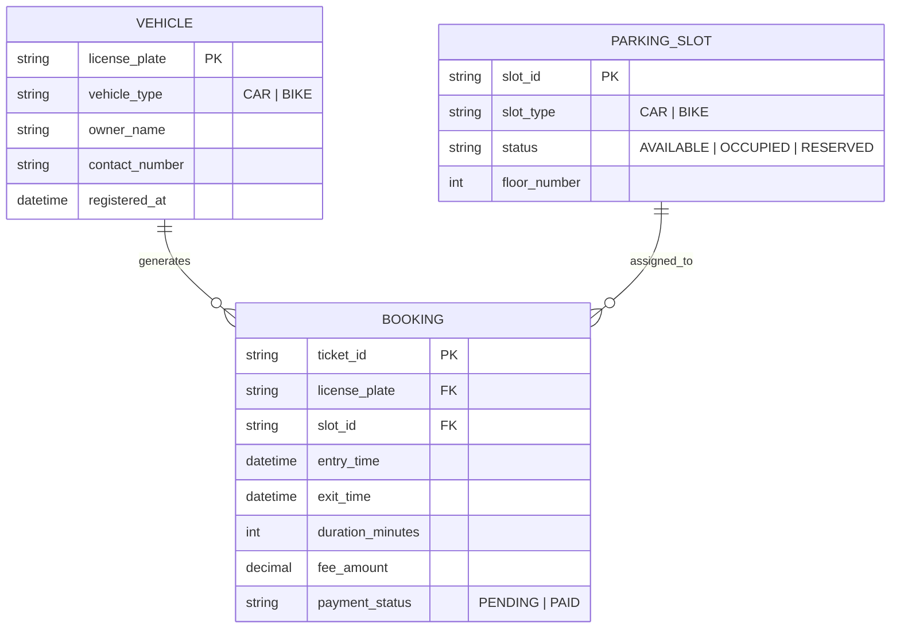
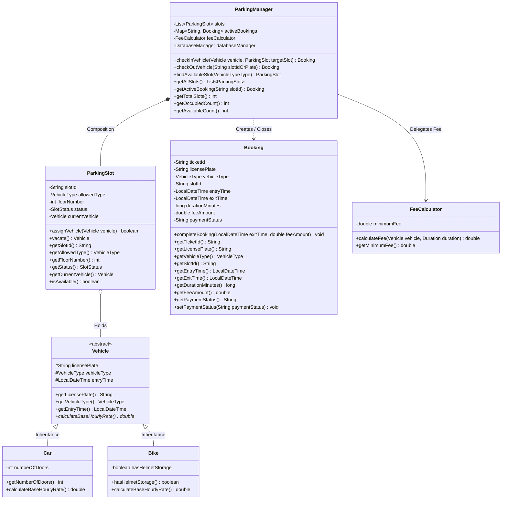

# CHAPTER 6 DIAGRAM SPECIFICATIONS: DFD, ER & UML

> **Team Rule:** Consistent notation across all diagrams. Use these diagrams in draw.io or embed the Mermaid diagrams directly into markdown viewers.

---

## 1. Entity-Relationship (ER) Diagram (Chapter 6)



---

## 2. UML Class Diagram (Chapter 5 / 6)



---

## 3. Data Flow Diagrams (DFD)

### 3.1 DFD Level 0 (Context Level Diagram)

```mermaid
flowchart LR
    Driver([Driver / Customer])
    Attendant([Parking Attendant / Admin])
    PLMS[((Parking Lot Management System))]
    DB[(PLMS Database)]

    Driver -->|1. Vehicle Arrival & Plate| PLMS
    PLMS -->|2. Entry Ticket & Slot Number| Driver

    Driver -->|3. Ticket at Exit| PLMS
    PLMS -->|4. Billing Receipt & Gate Clearance| Driver

    Attendant -->|Check Slot Status / Config| PLMS
    PLMS -->|Occupancy & Revenue Reports| Attendant

    PLMS <-->|Read / Write Records| DB
```

### 3.2 DFD Level 1 (Detailed Subsystem Flow)

```mermaid
flowchart TD
    Driver([Driver])
    P1[1.0 Vehicle Ingestion & Validation]
    P2[2.0 Slot Allocation Engine]
    P3[3.0 Real-Time Display Update]
    P4[4.0 Duration & Fee Calculator]
    P5[5.0 Payment & Slot Release]
    
    D1[(Slots Store)]
    D2[(Bookings Store)]
    D3[(Tariff Store)]

    Driver -->|Vehicle Plate & Type| P1
    P1 -->|Validated Vehicle| P2
    P2 <-->|Check Available Slots| D1
    P2 -->|Save Active Ticket| D2
    P2 -->|Assigned Slot Notification| Driver
    P2 -->|Update Slot State| P3

    Driver -->|Ticket ID at Exit| P4
    D2 -->|Fetch Entry Timestamp| P4
    D3 -->|Tariff Rates| P4
    P4 -->|Calculated Fee Due| Driver

    Driver -->|Payment Received| P5
    P5 -->|Mark Ticket Paid| D2
    P5 -->|Vacate Slot (Status=AVAILABLE)| D1
    P5 -->|Receipt Printout| Driver
    P5 -->|Slot Vacated Signal| P3
```
